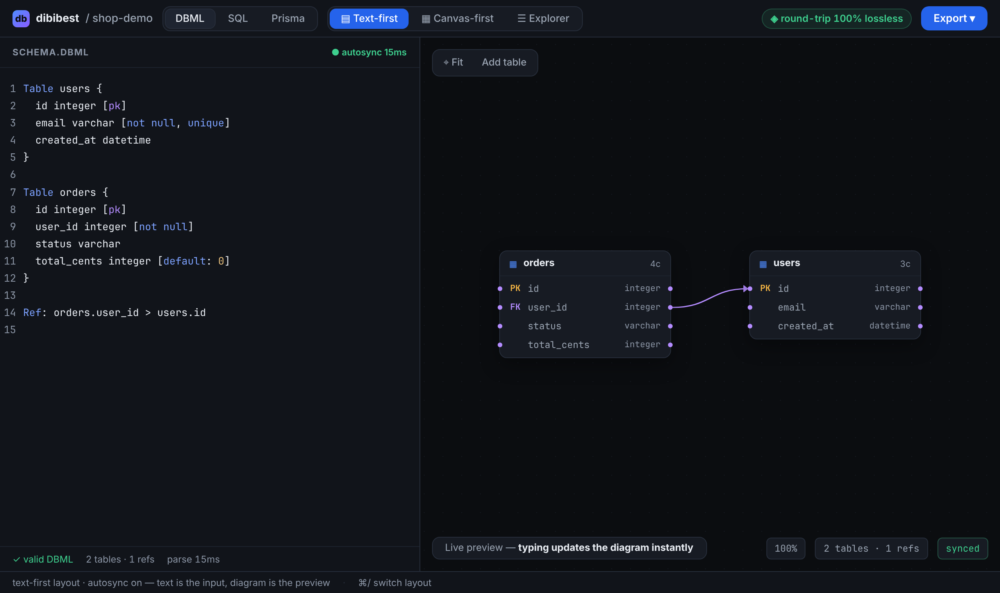
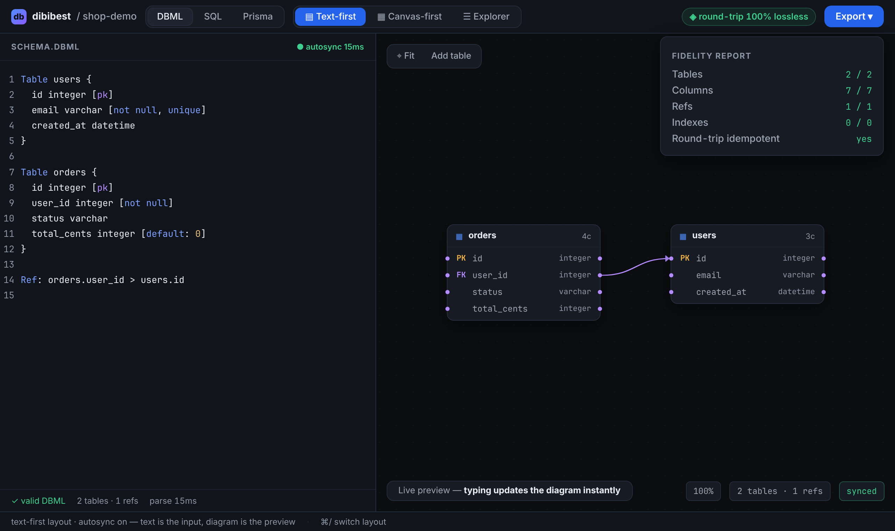
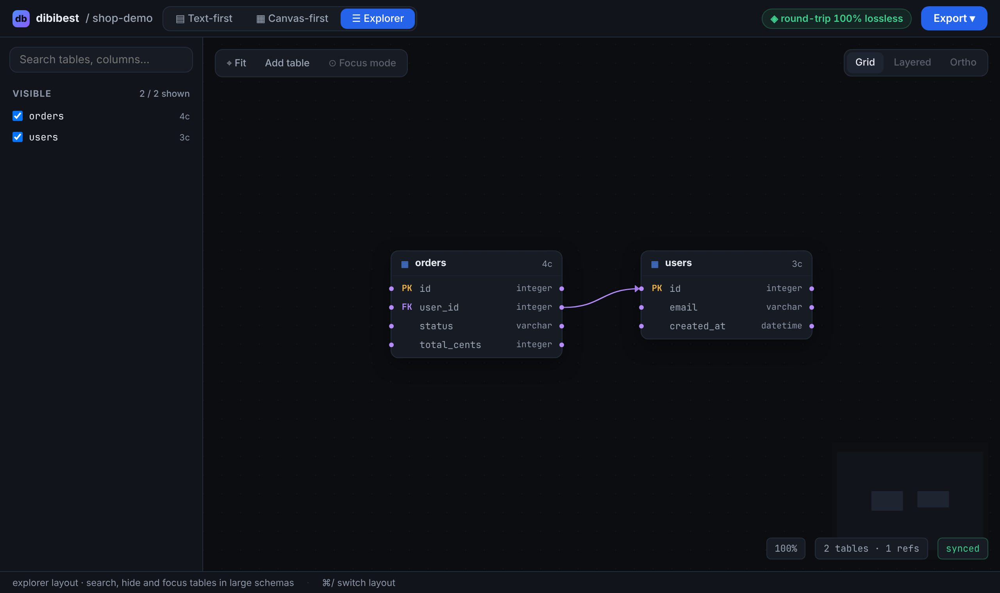

<p></p>

# dibibest

**Convert database schemas in both directions**: DBML (dbdiagram.io) ⇄ SQL DDL
(PostgreSQL, MySQL, SQLite) ⇄ Prisma ⇄ ERD-JSON, with a **fidelity report** on
every conversion: what survived, what leaked.

dbdiagram gives you design-first; Liam ERD gives you reverse-first. **dibibest
gives you both in one IR**, and measures for itself whether the round trip is
lossless.



> **Status: beta.** The core formats work and are round-trip tested in CI, but
> there are still known limitations (see [below](#beta-limitations)). If a
> conversion is wrong or its fidelity report lies, that is a bug:
> [open an issue](https://github.com/codecoradev/dibibest/issues/new) with a
> small schema that reproduces it.

```bash
# DBML → SQL (PostgreSQL)
dibibest convert --to sql schema.dbml

# SQL → DBML (source format is auto-detected)
cat schema.sql | dibibest convert --to dbml

# other dialects & formats
dibibest convert --to sql:mysql schema.dbml
dibibest convert --to prisma schema.dbml
dibibest formats            # dbml, sql, sql:mysql, sql:sqlite, prisma, erdjson

# ERD diagram as an SVG image
dibibest render --theme light schema.sql > erd.svg
```

A real example, DBML → SQL:

```dbml
Table users {
  id integer [pk]
  email varchar [not null, unique, note: 'login']
  plan varchar [default: 'free']
}

Table orders {
  id integer [pk]
  user_id integer [not null]
}

Ref: orders.user_id > users.id [delete: cascade]
```

```sql
CREATE TABLE users (
  id integer PRIMARY KEY,
  email varchar NOT NULL UNIQUE,
  plan varchar DEFAULT 'free'
);

CREATE TABLE orders (
  id integer PRIMARY KEY,
  user_id integer NOT NULL,
  FOREIGN KEY (user_id) REFERENCES users(id) ON DELETE CASCADE
);
```

Fidelity report (on stderr, so the output stays pipeable):

```
-- fidelity --
  tables   2/2 ✓
  columns  5/5 ✓
  refs     1/1 ✓
  indexes  0/0 ✓
  round-trip in source format: lossless ✓
  note: notes/comments have no equivalent in target format
```

## Why a fidelity report?

A schema conversion is either honest or it isn't. Other tools silently drop
partial indexes, enums, cascades, or notes. dibibest **always measures**:

- **kept/total per category.** Totals are counted from the source text, not from
  the parse result, so anything lost during parsing still shows up. Refs are
  matched by content (FK table/columns → target table/columns, plus
  `ON DELETE`/`ON UPDATE`), not just counted, so a reversed ref or one that lost
  its cascade is not counted as kept.
- **`dropped`:** whatever has no equivalent in the target format, by name.
- **Idempotency:** `parse(emit(parse(src))) == parse(src)` in the source format.

"Round-trip" is not a slogan; it is a test that runs on every conversion and in
CI, including a corpus of 12 real-world schemas converted to all six formats.

## Try it now

There are no release binaries yet; for the beta, build from source (requires
[Rust stable](https://rustup.rs)).

### CLI

```bash
cargo install --git https://github.com/codecoradev/dibibest dibibest-cli
dibibest --help
```

### MCP (for AI agents)

```bash
cargo install --git https://github.com/codecoradev/dibibest dibibest-mcp
```

```json
{ "mcpServers": { "dibibest": { "command": "dibibest-mcp" } } }
```

Or use the remote server (no install, CodeCora ID login via OAuth, no API key)
once the hosted version is live:

```json
{ "mcpServers": { "dibibest": { "url": "https://dibibest.codecora.dev/mcp" } } }
```

Tools:

- `convert_schema` (`source`, `from?`, `to`) → output + fidelity
- `render_diagram` (`source`, `from?`, `theme?` dark/light) → ERD diagram as SVG
- `list_formats`

Manifest: [server.json](server.json).

### Web (ERD + editor, runs entirely in the browser)

```bash
rustup target add wasm32-unknown-unknown
cd apps/web && bun install && bun run dev
```

Three layouts (text-first, canvas-first, explorer) over a single ERD-JSON;
conversions run through the same core, compiled to WASM. Nothing is uploaded.

The text editor helps as you write: `{ }`, `( )`, `[ ]` and quotes close
themselves and Enter indents the new line. **Tab** accepts a suggestion (column
types such as `int` → `integer`, the document's enums and table names, settings
like `pk` and `not null`, `table.column` in a `Ref`) or indents; **Esc, then Tab**
leaves the editor. **Format** (Shift+Alt+F) tidies indentation, trailing spaces
and blank lines without changing the content or the comments.

Projects are stored in the browser (IndexedDB), with no account and no server:
create, open, rename, and delete them from the project-name menu at the top
left. **Import** a `.dbml`, `.sql`, `.prisma`, or ERD-JSON file (`.json`, canvas
positions included) as a new project; **Export → Download** saves the schema in
any format. Project data lives only in that browser: use Download for backups or
to move to another device.

| Fidelity report (click the "round-trip" chip) | Explorer: search & hide tables in large schemas |
|---|---|
|  |  |

Hosted version: **https://dibibest.codecora.dev** (Cloudflare Pages).
The playground (edit, convert, diagram, fidelity report) is free to use without
an account; **Import**, **Copy**, and **Download** require signing in with
CodeCora ID. Sign-in runs on Pages Functions with no database (signed cookies).
Setup and deployment: [docs/deploy-web.md](docs/deploy-web.md).

## Format

| Format | Parse | Emit | Notes |
|---|---|---|---|
| DBML (dbdiagram) | ✓ | ✓ | Table/column + settings, indexes, Ref (`>` `<` `-`, optional `?`, composite, inline, blocks, `delete`/`update`), Enum, Project. See [docs/dbml-gaps.md](docs/dbml-gaps.md) |
| SQL: PostgreSQL (`sql`) | ✓ | ✓ | via sqlparser-rs; `CREATE TABLE`/`INDEX`/`TYPE … AS ENUM`, FK + `ON DELETE`/`ON UPDATE`. Autoincrement not emitted yet (see below) |
| SQL: MySQL (`sql:mysql`) | ✓ | ✓ | backtick quoting, `AUTO_INCREMENT`; enums not emitted (reported as `dropped`). See [docs/sql-dialects.md](docs/sql-dialects.md) |
| SQL: SQLite (`sql:sqlite`) | ✓ | ✓ | `AUTOINCREMENT`; enums not emitted (reported as `dropped`) |
| Prisma | ✓ | ✓ | hand-written subset: models, fields, `@id`/`@unique`/`@default`, `@relation` (+ `onDelete`/`onUpdate`), enums. See [docs/prisma-integration.md](docs/prisma-integration.md) |
| ERD-JSON | ✓ | ✓ | canvas contract: [docs/erdjson-schema.md](docs/erdjson-schema.md) |
| Live-DB introspect | – | – | roadmap |

## Beta limitations

**Rejected with an error** (never silently dropped) in DBML: `TableGroup`,
table aliases (`Table users as U`), `Note { … }` blocks, multi-line notes
(`'''…'''`), many-to-many relations (`<>`), `checks`, `TablePartial`, and
`Records`.

Known to be unsupported:

- **Expression/partial index** (`` (`lower(email)`) ``, `` (`fired_at WHERE resolved = false`) ``)
  are emitted to PostgreSQL and SQLite (`((lower(email)))`, `… WHERE …`), but
  MySQL and Prisma have no equivalent: such an index is dropped and named in
  `dropped`. An index with no key column (`` (`WHERE …`) ``) cannot be emitted
  to SQL at all.
- **Autoincrement to PostgreSQL** is not emitted yet (`SERIAL`/`IDENTITY`);
  MySQL and SQLite already are. See [docs/sql-dialects.md](docs/sql-dialects.md).

Changes shape but still round-trips (canonicalization):

- DBML `//` comments are dropped.
- Inline refs are moved to their own `Ref:` line.
- Setting order is normalized.

Full details are in [docs/dbml-gaps.md](docs/dbml-gaps.md). Progress toward the
first beta release is tracked in
[#44](https://github.com/codecoradev/dibibest/issues/44).

## Development

```bash
cargo fmt --all && cargo clippy --workspace --all-targets -- -D warnings
cargo test --workspace          # round-trip conformance + cross-format corpus
cargo run -p dibibest-cli -- --help
```

Roadmap: [docs/ROADMAP.md](docs/ROADMAP.md) · Architecture:
[docs/ARCHITECTURE.md](docs/ARCHITECTURE.md) · Contributing:
[CONTRIBUTING.md](CONTRIBUTING.md)

## License

MIT. See [LICENSE](LICENSE).
